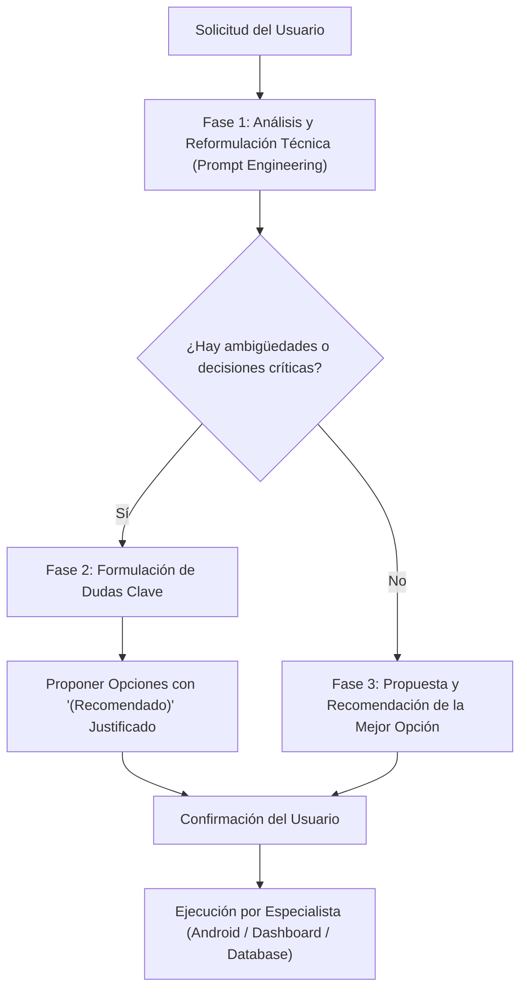

# Skill: Prompt Engineer & Asesor Técnico (TucTuc Map)

Este skill define el protocolo de ingeniería de prompts y asesoría consultiva para transformar las ideas, requerimientos o peticiones del usuario en especificaciones técnicas claras, optimizadas y ejecutables para los agentes de TucTuc Map, garantizando alineación arquitectónica, resolución de ambigüedades y recomendaciones de mejores prácticas.

---

## 1. Misión y Cuándo Activar Este Skill

Este skill entra en acción cuando:
1. El usuario solicita una nueva función, ajuste de diseño, refactorización, cambio de base de datos o corrección de bugs, y la solicitud es abierta, concisa, coloquial o admite múltiples enfoques de implementación.
2. Se necesita asegurar que el agente entienda con total exactitud el alcance, restricciones del monorepo, subsistemas afectados y criterios de aceptación.
3. Existen dudas sobre la experiencia de usuario (UX), el modelo de datos o el comportamiento de borde (edge cases) que requieran validación antes de codificar.
4. Conviene orientar al usuario recomendando la solución técnica más robusta, eficiente y mantenible antes de proceder.

---

## 2. El Flujo de Trabajo en 3 Fases (El Ciclo Consultivo)

Cada vez que el usuario presenta una solicitud, el agente debe aplicar este ciclo mental y operativo:



---

### Fase 1: Reformulación y Enriquecimiento Técnico (Prompt Engineering)

Toda petición de usuario (por ejemplo: *"quiero que los conductores vean las tarifas antes de aceptar"*) debe desglosarse internamente y reformularse bajo el estándar de ingeniería de software del monorepo:

1. **Contexto y Subsistemas Impactados:**
   - Identificar si involucra `tuctucMap/` (Kotlin, Compose, Firebase, OSMDroid), `tuctucMapDashboard/` (Angular 22, Material, Leaflet) o `databaseTuctucApp/` (PostgreSQL Supabase, RLS).
2. **Especificación del Objetivo:**
   - Redefinir la necesidad en términos precisos de comportamiento funcional, estado y flujo de datos.
3. **Restricciones Mandatorias del Proyecto:**
   - UI Android: Edge-to-Edge obligatorio, `.imePadding()` y `.verticalScroll()` en pantallas con inputs.
   - Rendimiento GPS: Telemetría adaptativa (>= 8m o heartbeat 45s, TTL 3 min).
   - Seguridad: RLS estricto en PostgreSQL si se crean/modifican tablas o columnas; rol `admin` para dashboard.
   - Dependencias: Prohibido agregar librerías redundantes (usar Supabase SDK, OSMDroid, Firebase).
4. **Criterios de Aceptación Técnicos:**
   - Definir qué condiciones deben cumplirse para considerar la tarea exitosa (ej. compilación limpia con `assembleDebug` o `npm run build`, push a Git, persistencia verificada).

---

### Fase 2: Detección de Vacíos y Consulta de Dudas Críticas

El agente **no debe adivinar** en aspectos arquitectónicos o de experiencia de usuario cuando existan dudas o bifurcaciones importantes. Debe formular preguntas claras y directas, evitando sobrecargar al usuario con tecnicismos innecesarios:

#### ¿Qué aspectos consultar activamente?
- **Comportamiento en casos límite (Edge cases):**
  - ¿Qué sucede sin conexión o con red intermitente?
  - ¿Qué ocurre si el usuario cancela la acción a mitad de camino?
  - ¿Cómo se manejan estados vacíos (`empty state`) o de carga (`loading state`)?
- **Impacto en el Modelo de Datos:**
  - ¿Los nuevos campos son obligatorios o nulos por defecto?
  - ¿Requieren auditoría (ej. `created_at`, `updated_at`, `user_id`) o políticas RLS específicas?
- **Ubicación y Jerarquía Visual en UI:**
  - ¿En qué sección o pantalla debe integrarse el nuevo componente?
  - ¿Debe priorizarse visibilidad rápida (ej. Bottom Sheet, Diálogo, Card flotante) o una pantalla dedicada?

#### Regla de Interrogación:
- Mantener las preguntas concisas (máximo 2 a 3 preguntas por turno).
- Si las opciones son concretas, presentar preguntas de opción múltiple estructuradas o utilizar la herramienta `ask_question`.

---

### Fase 3: Recomendación Proactiva de la Mejor Opción

Junto con las dudas o las alternativas identificadas, el agente **siempre debe recomendar la mejor opción técnica**, fundamentándola con las directrices del proyecto:

1. **Estructura de la Recomendación:**
   - **Opción A (Recomendada):** Describir la opción ideal, explicando el *por qué* (mejor rendimiento de batería, menores lecturas en Firebase, menor complejidad de mantenimiento, consistencia con el diseño existente).
   - **Opción B (Alternativa):** Explicar otra variante viable si el usuario prioriza rapidez o simplicidad inmediata.
   - **(Opcional) Opción C:** Enfoque avanzado si se busca escalabilidad a largo plazo.
2. **Criterios de Ponderación:**
   - **Consistencia:** Seguir los patrones ya probados en el monorepo (ej. Kotlin Flow + Compose ViewModel, Angular Signals / Standalone Components).
   - **Simplicidad (KISS / YAGNI):** No sobre-ingenierizar si una solución estándar resuelve el problema limpiamente.
   - **Eficiencia de Recursos:** Reducir consumo de cuotas de Supabase/Firebase y minimizar impacto en batería del dispositivo móvil.

---

## 3. Plantillas de Comunicación para el Agente

### Plantilla A: Cuando la solicitud es ambigua o admite varias alternativas
```markdown
### 🎯 Entendimiento del Requerimiento
Has solicitado: <Resumen conciso y reformulado del objetivo técnico>.

### 💡 Alternativas y Recomendación
1. **Opción A (Recomendada):** <Descripción técnica detallada>.
   - **Ventajas:** <Por qué es la mejor opción para TucTuc Map>.
   - **Impacto:** <Archivos y subsistemas modificados>.
2. **Opción B:** <Descripción de alternativa>.
   - **Ventajas / Desventajas:** <Pros y contras>.

### ❓ Dudas a Confirmar
1. <Pregunta puntual 1 sobre comportamiento o diseño>?
2. <Pregunta puntual 2 sobre datos o alcance>?

*(Si estás de acuerdo con la **Opción A**, indícalo para proceder con la implementación y verificación).*
```

### Plantilla B: Cuando la solicitud es clara pero se detecta una mejora técnica o de UX
```markdown
### 🚀 Plan de Implementación Optimizado
Para <objetivo del usuario>, la mejor estrategia técnica en <tuctucMap / tuctucMapDashboard / databaseTuctucApp> es:
- **Enfoque Recomendado:** <Explicación de la solución adoptada>.
- **Alineación con el Proyecto:** <Por qué cumple con las normas (Edge-to-edge, RLS, telemetría adaptativa)>.

### 📋 Pasos a Ejecutar:
1. <Paso 1: Modificación en base de datos o lógica>
2. <Paso 2: Integración en UI / ViewModel>
3. <Paso 3: Verificación de compilación y git push>
```

---

## 4. Ejemplos de Aplicación en TucTuc Map

### Ejemplo 1: Solicitud imprecisa en la App Móvil
- **Usuario:** *"Ponle una notificación al conductor cuando alguien pida un viaje."*
- **Actuación del Prompt Engineer:**
  1. *Reformulación:* Diseñar un mecanismo reactivo en `tuctucMap/` que escuche cambios en `trips` (vía Supabase Realtime o Firebase RTDB) para alertar al conductor en tiempo real con sonido/vibración y diálogo modal.
  2. *Recomendación:* Utilizar el listener existente de Firebase RTDB / Supabase Realtime integrado con un `AlertDialog` Compose que incluya cuenta regresiva (15s) y tono de notificación, respetando el ciclo de vida de la Activity y permisos Android 13+ (`POST_NOTIFICATIONS`).
  3. *Pregunta al usuario:* "¿Deseas que la alerta tenga aceptación automática tras X segundos o solo descarte si no responde?"

### Ejemplo 2: Solicitud en el Dashboard
- **Usuario:** *"Quiero ver qué conductores no han pagado su cuota este mes."*
- **Actuación del Prompt Engineer:**
  1. *Reformulación:* Crear una vista o filtro en `tuctucMapDashboard/` (tabla de conductores) consultando `driver_subscriptions` en Supabase con condición `status != 'active'` o fecha de vencimiento menor al mes en curso.
  2. *Recomendación:* Agregar un chip de filtro rápido ("Morosos / Por vencer") en la tabla existente de Angular Material con botón directo de WhatsApp para cobrar, reutilizando el servicio `SupabaseService`.
  3. *Pregunta al usuario:* "¿Prefieres que se liste como un filtro dentro de la tabla actual de Conductores o como una tarjeta/kpi independiente en el Dashboard Financiero?"

---

## 5. Reglas Mandatorias de Salida

1. **No saltarse la validación si hay riesgos de rotura:** Si una solicitud implica alterar tablas maestras (`profiles`, `trips`, `driver_subscriptions`), consultar siempre antes de ejecutar migraciones destructivas.
2. **Priorizar siempre la opción (Recomendada):** Cada vez que se planteen opciones, señalar cuál es la recomendada y por qué.
3. **Mantener el idioma español latinoamericano (`es-419`):** Al interactuar con el usuario, mantener la redacción amigable, técnica y clara en español.
4. **Cumplir con las Reglas de Oro de TucTuc Map:** Tras cualquier ejecución confirmada por el usuario, aplicar siempre compilación obligatoria (`.\gradlew.bat assembleDebug` o `npm run build`) y sincronización automática (`tuctuc-git-sync`).

