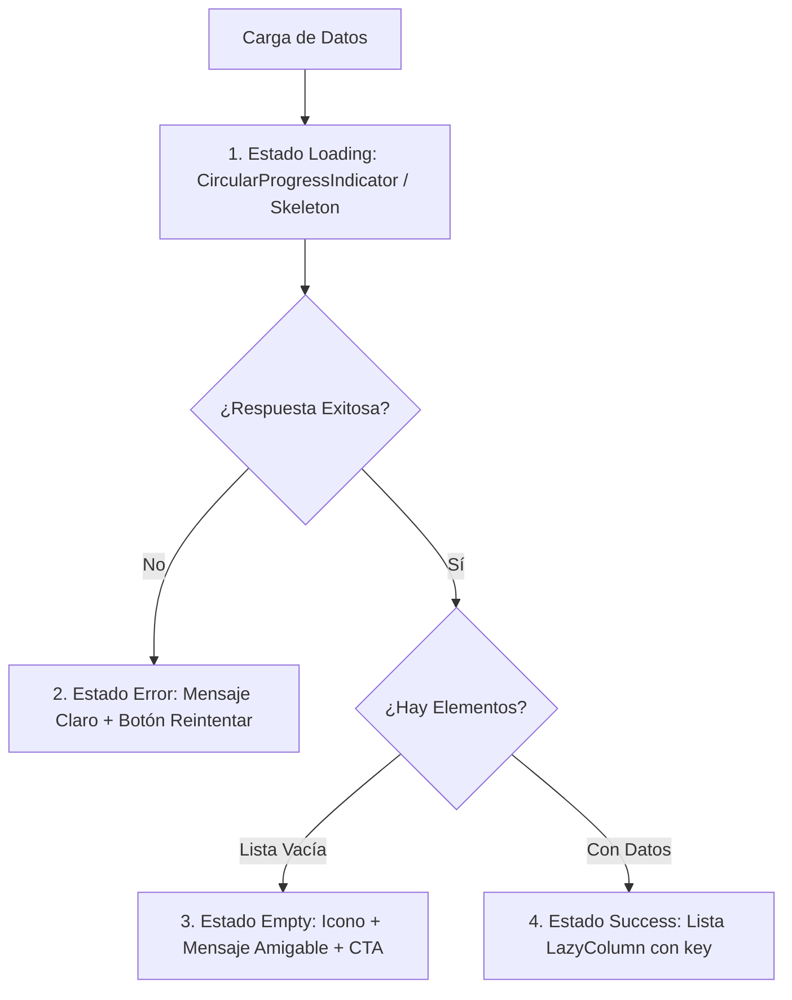

# Skill: Buenas Prácticas y Calidad Visual de Interfaces Android (TucTuc Map)

Esta guía define las directrices obligatorias, estándares de diseño en Jetpack Compose (Material 3) y patrones de control de calidad visual para la aplicación móvil nativa `tuctucMap/`.

---

## 1. Activación Mandatoria del Skill

Este skill **DEBE ejecutarse obligatoriamente** siempre que:
1. Se cree una nueva pantalla (`ui/screens/`), componente (`ui/components/`) o diálogo.
2. Se modifique, estilice o refactorice cualquier vista existente de pasajeros (`passenger/`), conductores (`driver/`) o administradores (`admin/`).
3. Se detecte o reporte un problema visual: campos cubiertos por el teclado, textos cortados, parpadeo (flickering), solapamiento de botones con la barra de navegación o saltos bruscos en listas.

---

## 2. Insets del Sistema, Edge-to-Edge y Manejo del Teclado (IME)

El error visual más frecuente en Android es el ocultamiento de campos de entrada o botones de acción detrás del teclado virtual o las barras del sistema.

### 2.1. Regla Inquebrantable para Formularios y Campos de Entrada
TODA pantalla, tarjeta o diálogo que contenga uno o más campos de texto (`TextField`, `OutlinedTextField`) **DEBE** implementar:
1. `Modifier.imePadding()` en el contenedor del formulario o en el layout raíz.
2. `Modifier.verticalScroll(rememberScrollState())` en la columna contenedora para que la vista pueda desplazarse automáticamente cuando el teclado se despliega, permitiendo ver el campo activo y los botones de acción ("Guardar", "Confirmar", "Enviar").

```kotlin
// Patrón correcto en pantallas con formularios
Column(
    modifier = Modifier
        .fillMaxSize()
        .imePadding()
        .verticalScroll(rememberScrollState())
        .padding(horizontal = 16.dp, vertical = 12.dp),
    verticalArrangement = Arrangement.spacedBy(16.dp)
) {
    OutlinedTextField(
        value = textValue,
        onValueChange = { textValue = it },
        label = { Text("Nombre completo") },
        modifier = Modifier.fillMaxWidth()
    )
    Button(
        onClick = { /* Acción */ },
        modifier = Modifier.fillMaxWidth()
    ) {
        Text("Guardar Cambios")
    }
}
```

### 2.2. Manejo de Scaffold e Insets de Navegación
- Al usar `Scaffold`, aplicar SIEMPRE el `innerPadding` proporcionado al Composable principal:
  ```kotlin
  Scaffold(
      topBar = { /* TopAppBar */ },
      bottomBar = { /* NavigationBar */ }
  ) { innerPadding ->
      Box(modifier = Modifier.padding(innerPadding)) {
          // Contenido principal de la pantalla
      }
  }
  ```
- **Evitar Doble Padding:** No combinar `Modifier.padding(innerPadding)` con modificadores como `Modifier.statusBarsPadding()` o `Modifier.systemBarsPadding()` en el mismo contenedor secundario, ya que esto duplica el espacio y deja márgenes vacíos antiestéticos.
- **Elementos Flotantes (FABs, Tarjetas sobre Mapas):** Añadir `Modifier.navigationBarsPadding()` cuando un elemento flotante esté anclado en la parte inferior fuera de un `Scaffold` con `bottomBar` para no ser tapado por los gestos del sistema Android.

---

## 3. Paleta Cromática y Tema Oficial (Dark Mode por Defecto)

La aplicación utiliza `TuctucMapTheme` configurado por defecto en tema oscuro (`Color.kt` y `Theme.kt`).

### 3.1. Tokens Oficiales de Color
| Token | Valor Hex | Uso Principal |
| :--- | :--- | :--- |
| `TucTucYellow` | `#F9D423` | Botones de acción principal (CTA), acentos destacados, iconos de tuctuc |
| `TucTucAmber` | `#F59E0B` | Estados pendientes, advertencias, detalles secundarios |
| `TucTucGreen` | `#10B981` | Estados activos, éxito, aprobaciones, tarifas y ganancias |
| `TucTucWhatsAppGreen` | `#25D366` | Botones de enlace o contacto directo con WhatsApp |
| `TucTucSkyBlue` | `#38BDF8` | Enlaces interactivos, chips informativos, indicadores de geolocalización |
| `TucTucCyan` | `#00D2FF` | Ondas de pulso y animación del radar de pasajero |
| `TucTucRed` | `#EF4444` | Errores, rechazos, expiración de suscripciones y acciones destructivas |
| `SlateBackground` | `#0F172A` | Fondo general de todas las pantallas (`background`) |
| `SlateSurface` | `#1E293B` | Superficie de tarjetas (`Card`), diálogos y hojas modales |
| `SlateSurfaceVariant` | `#334155` | Fondos de campos de texto, chips deseleccionados y divisores |
| `SlateBorder` | `#475569` | Bordes sutiles de tarjetas y divisores (`outline`) |
| `TextPrimary` | `#F8FAFC` | Títulos y texto de alto contraste |
| `TextSecondary` | `#94A3B8` | Subtítulos, labels descriptivos y placeholders |
| `TextMuted` | `#64748B` | Textos deshabilitados, timestamps y notas al pie |

### 3.2. Reglas de Contraste y Legibilidad
- **Prohibido colores ciegos:** NUNCA usar `Color.Black` para texto ni colocar texto gris oscuro sobre fondos `SlateSurface` o `SlateBackground`.
- Al estilizar `OutlinedTextField`, usar `OutlinedTextFieldDefaults.colors()` asegurando que el texto enfocado (`focusedTextColor = TextPrimary`), no enfocado (`unfocusedTextColor = TextPrimary`), bordes y labels sean perfectamente legibles.
- En botones primarios con fondo `TucTucYellow`, usar texto oscuro (`Color(0xFF0F172A)`) para garantizar el máximo ratio de contraste WCAG.

---

## 4. Tipografía, Dimensionamiento y Accesibilidad Visual

### 4.1. Unidades Estrictas: `dp` vs `sp`
- Usar `dp` **exclusivamente** para dimensiones de layout: `padding`, `margin`, `size`, `width`, `height`, `elevation`, `corner radius`.
- Usar `sp` **exclusivamente** para propiedades de texto: `fontSize`, `lineHeight`, `letterSpacing`.

### 4.2. Prevención de Textos Cortados por Escalado de Fuente (Font Scaling)
Muchos usuarios de TucTuc Map configuran texto grande en la configuración de accesibilidad de su teléfono Android. Para evitar que la interfaz se rompa:
- **No fijar alturas rígidas en tarjetas o botones con texto:** En lugar de `Modifier.height(48.dp)`, preferir `Modifier.defaultMinSize(minHeight = 48.dp)` o `Modifier.wrapContentHeight()`.
- **Textos en Filas (`Row`):** Usar siempre `Modifier.weight(1f)` en el Composable `Text` cuando comparta fila con iconos o badges, evitando que empuje los elementos fuera de la pantalla.
- **Trunkado Seguro:** Si un texto puede ser largo (como la dirección o el destino), utilizar:
  ```kotlin
  Text(
      text = destinationName,
      maxLines = 1,
      overflow = TextOverflow.Ellipsis,
      modifier = Modifier.weight(1f)
  )
  ```

### 4.3. Área Mínima de Toque (Touch Target Size)
- Todo elemento clickeable (`IconButton`, `Button`, `Chip`, `Checkbox`, `Switch`) debe garantizar un área de interacción de al menos **`48.dp` x `48.dp`**.
- Si el icono visual mide `24.dp`, envolverlo en un `Box(modifier = Modifier.size(48.dp), contentAlignment = Alignment.Center)` o utilizar `IconButton`.

---

## 5. Manejo Integral de los 4 Estados de UI (State Management)

Toda pantalla o sección de datos dinámicos debe contemplar y renderizar explícitamente los siguientes 4 estados:



1. **Estado de Carga (Loading):**
   - Centrar `CircularProgressIndicator(color = TucTucYellow)` acompañado de un texto descriptivo (ej. *"Cargando solicitudes de viaje..."*).
2. **Estado Vacío (Empty State):**
   - No dejar la pantalla en negro o vacía. Mostrar un icono representativo de `48.dp` o `64.dp`, un título explicativo y una sugerencia de acción.
3. **Estado de Error (Error State):**
   - Tarjeta informativa con borde `TucTucRed`, mensaje en lenguaje humano (sin volcar JSON ni stack traces crudos al usuario final) y un botón interactivo *"Reintentar"*.
4. **Estado Exitoso (Success State):**
   - Despliegue fluido de la información mediante componentes perezosos.

---

## 6. Listas Perezosas (`LazyColumn` / `LazyRow`) y Recomposición

Las listas sin optimizar causan caídas de frames y reinicios visuales molestos al actualizarse los datos.

### 6.1. Claves Estables Obligatorias (`key`)
SIEMPRE proveer una clave única y estable en el método `items()`:
```kotlin
// Correcto: Permite a Compose reutilizar vistas sin parpadeo
LazyColumn(
    contentPadding = PaddingValues(16.dp),
    verticalArrangement = Arrangement.spacedBy(12.dp)
) {
    items(
        items = tripsList,
        key = { trip -> trip.id }
    ) { trip ->
        TripCardItem(trip = trip)
    }
}
```
*Nunca omitir el parámetro `key` cuando los elementos se puedan actualizar, reordenar o eliminar.*

### 6.2. Optimización de Lambdas y Estados Derivados
- Pasar lambdas directas o referencias a funciones (`onAction = viewModel::onAction`) en lugar de instanciar lógica pesada en el cuerpo del Composable.
- Usar `remember(key) { ... }` para cálculos derivados costosos (como formateo de fechas o distancias).
- Usar `derivedStateOf` cuando un estado dependa de la posición de scroll de la lista (`LazyListState.firstVisibleItemIndex`).

---

## 7. Modales, Hojas Inferiores (`ModalBottomSheet`) y Diálogos

1. **Hojas Inferiores Completas:**
   - Para formularios o detalles extensos, configurar `rememberModalBottomSheetState(skipPartiallyExpanded = true)` para evitar que la hoja se quede trabada a la mitad en pantallas de menor altura.
   - Si la hoja contiene campos de texto, incluir `Modifier.imePadding()` dentro de su contenido.
2. **Fondo y Forma de Diálogos:**
   - Usar `SlateSurface` como `containerColor` y bordes redondeados consistentes (`RoundedCornerShape(16.dp)` o `24.dp`).
   - Todos los diálogos deben proveer un botón de cancelación claro y respetar el botón Atrás (`onDismissRequest`).

---

## 8. Integración Visual de Mapas OSMDroid en Compose

Al incrustar vistas de mapa con `AndroidView`:
1. **Sin Flickering:** Usar `update` de `AndroidView` para refrescar polilíneas o marcadores en lugar de recrear el `MapView` en el `factory`.
2. **Caché de Iconos (`MarkerIconUtils`):**
   - Usar únicamente drawables WebP preprocesados (`res/drawable-nodpi/`) escalados a `48.dp` mediante `MarkerIconUtils.getTucTucIcon(context)` o `getPassengerPickupIcon(context)`.
   - Evitar decodificar Bitmaps repetidamente dentro del ciclo de dibujo de Compose.
3. **Pausar Animaciones en Segundo Plano:**
   - Asegurarse de que el `MapView` esté vinculado al ciclo de vida con `LifecycleEventObserver` para pausar animaciones como `PassengerLocationOverlay` cuando la app pase a segundo plano.

---

## 9. Checklist de Verificación de Calidad Visual Pre-Commit

Antes de dar por finalizada la creación o modificación de cualquier interfaz en `tuctucMap`, revisar este checklist:

- [ ] **Teclado:** ¿Todos los campos de texto tienen `.imePadding()` y el contenedor tiene `.verticalScroll()`?
- [ ] **Insets:** ¿Se respeta el `innerPadding` de `Scaffold` sin generar doble margen ni solapar la barra de estado?
- [ ] **Contraste:** ¿Todos los textos usan `TextPrimary` / `TextSecondary` legibles sobre el fondo oscuro `SlateBackground`?
- [ ] **Área de Toque:** ¿Los iconos y botones clickeables tienen un área mínima de interacción de `48.dp` x `48.dp`?
- [ ] **Textos Largos:** ¿Los textos dinámicos usan `weight(1f)` y/o `TextOverflow.Ellipsis` para no salirse de la pantalla?
- [ ] **Estados:** ¿Se gestionaron adecuadamente los estados de carga, vacío, error y contenido?
- [ ] **Listas:** ¿Todos los `LazyColumn` y `LazyRow` tienen `key = { it.id }` en sus `items`?
- [ ] **Modales:** ¿Los `ModalBottomSheet` tienen `skipPartiallyExpanded = true` y no bloquean el teclado?
