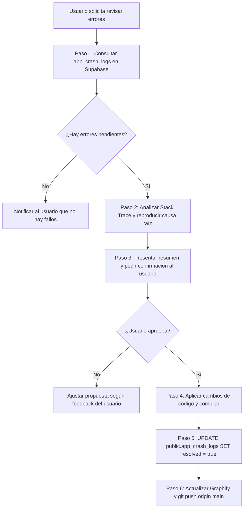

# Skill: Resolución y Auditoría de Crashes (TucTuc Map)

Esta guía define el protocolo obligatorio para inspeccionar la telemetría de errores almacenada en Supabase (`public.app_crash_logs`), diagnosticar la causa raíz en el código fuente, presentar las soluciones al usuario para su aprobación y aplicar los parches con validación de compilación.

---

## 1. Activación del Skill

Este runbook se activa cuando el usuario solicite:
* *"Revisa los errores/crashes reportados en la base de datos."*
* *"¿Hay algún fallo pendiente en la app?"*
* *"Revisa y arregla los errores que mandaron los teléfonos."*
* *"Soluciona las excepciones reportadas por los usuarios."*

---

## 2. Protocolo de Ejecución en 6 Pasos



---

### Paso 1: Consultar Incidencias Pendientes en Supabase

Ejecutar la consulta segura desde `databaseTuctucApp/` mediante Node.js:

```powershell
node databaseTuctucApp/run_sql.js "SELECT id, device_brand, device_model, device_manufacturer, android_version, sdk_int, app_version, build_number, build_type, error_type, error_message, stack_trace, thread_name, role, user_email, created_at FROM public.app_crash_logs WHERE resolved = false ORDER BY created_at DESC LIMIT 15;"
```

#### Clasificación Inicial:
* **Crashes Intencionales de Prueba:** Si el mensaje contiene `"Prueba de Telemetría TucTuc Map - Crash intencional"`, identificarlo como generado por el Easter Egg de prueba del desarrollador.
* **Fallos Reales de Código:** Excepciones como `NullPointerException`, `IndexOutOfBoundsException`, `ClassCastException`, `IllegalStateException`, `SecurityException`, etc.

---

### Paso 2: Análisis y Diagnóstico de Causa Raíz

Para cada fallo real pendiente:
1. **Localizar archivo y línea:** Inspeccionar el `stack_trace` para extraer el archivo `.kt` (o `.ts`) y la línea exacta donde reventó la ejecución.
2. **Contexto de Hardware y Sistema Operativo:**
   * Revisar `android_version` y `sdk_int` (ej. cambios de comportamiento en Android 13/14 con permisos de notificaciones o servicios en segundo plano).
   * Revisar `device_brand` (fabricantes como Xiaomi/Samsung aplican políticas agresivas de batería sobre foreground services).
3. **Análisis de Impacto con Graphify:**
   * Consultar qué otros componentes interactúan con el archivo afectado:
     ```powershell
     python -m graphify query "afectados por <NombreDelArchivo.kt>"
     ```

---

### Paso 3: Presentar Resumen y Solicitar Confirmación (Obligatorio)

**REGLA MANDATORIA:** El agente **NUNCA** debe aplicar los cambios de código inmediatamente sin antes consultar y esperar la confirmación explícita del usuario.

El agente debe redactar un resumen claro en el chat con la siguiente estructura:

1. **Tabla de Incidencias Detectadas:**
   * ID (primeros 8 caracteres)
   * Dispositivo y SO (ej. Samsung SM-S911B, Android 16)
   * Tipo de Excepción y Archivo/Línea causante
   * Fecha de ocurrencia
2. **Diagnóstico Técnico:**
   * Explicación de por qué ocurrió el error.
3. **Propuesta de Solución:**
   * Qué archivo se modificará.
   * La lógica que se añadirá (ej. comprobación de nulabilidad, bloque `try/catch`, validación defensiva de estado, etc.).
4. **Pregunta Explícita al Usuario:**
   * *"¿Estás de acuerdo con estas soluciones para proceder a aplicarlas y compilar?"*

---

### Paso 4: Aplicar Cambios y Compilar (Tras Aprobación)

Una vez que el usuario responde afirmativamente (*"sí"*, *"adelante"*, *"hazlo"*, etc.):

1. **Modificar el código:** Aplicar las ediciones con la herramienta `edit_file`.
2. **Compilar y Verificar (Regla 6 de AGENTS.md):**
   * Si afectó la app móvil Android (`tuctucMap/`):
     ```powershell
     cd tuctucMap
     .\gradlew.bat assembleDebug
     ```
     Verificar que la salida sea `BUILD SUCCESSFUL`.
   * Si afectó el dashboard web (`tuctucMapDashboard/`):
     ```powershell
     cd tuctucMapDashboard
     npm run build
     ```
     Verificar que finalice con `Application bundle generation complete`.
3. Si la compilación arroja errores, corregirlos proactivamente hasta que compile con éxito.

---

### Paso 5: Marcar Incidencias como Resueltas en Supabase

Una vez verificado que el parche de código compila correctamente:

1. Ejecutar el script SQL para actualizar las incidencias resueltas:
   ```powershell
   node databaseTuctucApp/run_sql.js "UPDATE public.app_crash_logs SET resolved = true, resolved_at = NOW() WHERE id IN ('<uuid-1>', '<uuid-2>');"
   ```
2. Si había crashes intencionales de prueba (Easter Egg) que el usuario solicitó limpiar o cerrar:
   ```powershell
   node databaseTuctucApp/run_sql.js "UPDATE public.app_crash_logs SET resolved = true, resolved_at = NOW() WHERE error_message LIKE '%Crash intencional%';"
   ```
3. Verificar que el conteo de no resueltos disminuyó:
   ```powershell
   node databaseTuctucApp/run_sql.js "SELECT COUNT(*) as pendientes FROM public.app_crash_logs WHERE resolved = false;"
   ```

---

### Paso 6: Sincronización de Grafo y Push a GitHub

Siguiendo el protocolo mandatorio de [`tuctuc-git-sync`](../tuctuc-git-sync/SKILL.md) y [`graphify.md`](../../rules/graphify.md):

1. **Refrescar Grafo de Conocimiento:**
   ```powershell
   python -m graphify update .
   ```
2. **Preparar y commitear cambios con mensaje semántico:**
   ```powershell
   git add .
   git commit -m "fix(crash): resolver <tipo_de_error> reportado en <dispositivo>"
   git push origin main
   ```

---

## 3. Ejemplo Práctico de Interacción

**Usuario:** *"Revisa si hay errores reportados en la base de datos y arréglalos"*

**Agente:**
1. Ejecuta `node databaseTuctucApp/run_sql.js "SELECT ... WHERE resolved = false"`
2. Analiza los resultados y responde al usuario:
   > *"He consultado la base de datos y encontré 1 incidencia pendiente:*
   > * * **Dispositivo:** Samsung Galaxy S23 (SM-S911B) - Android 16
   > * * **Excepción:** `NullPointerException` en `PassengerMapScreen.kt:142`
   > * * **Causa:** `passengerLocation` era nula al pulsar el botón de centrado antes de que el GPS fijara la posición.
   > * * **Solución:** Agregar un chequeo defensivo `if (currentLocation != null)` y mostrar un Toast solicitando esperar la señal GPS.
   >
   > *¿Estás de acuerdo con aplicar esta solución y marcar la incidencia como resuelta en Supabase?"*
3. **Usuario:** *"Sí, aplícalo"*
4. **Agente:** Aplica el parche con `edit_file`, ejecuta `.\gradlew.bat assembleDebug`, ejecuta el `UPDATE` en Supabase, refresca `graphify`, hace `git push origin main` y notifica al usuario el éxito de la operación.
