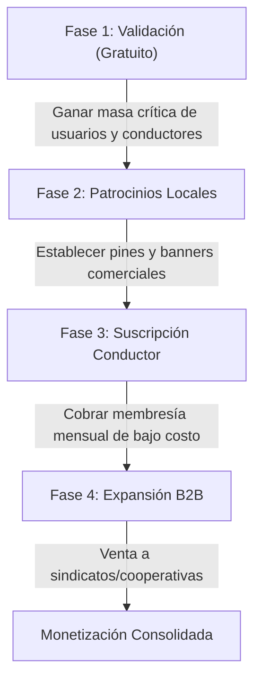

# Plan de Monetización y Negocio: TucTuc Map App

Este documento presenta una estrategia detallada y realista para monetizar la aplicación **TucTuc Map** sin elevar drásticamente los costos operativos de desarrollo o infraestructura.

---

## 1. Modelo SaaS: Suscripción para Conductores (Recomendado)

En lugar de cobrar comisiones altas por viaje, el modelo de suscripción mensual para conductores es el más limpio y fácil de implementar, ya que los conductores ya están registrados.

### Mecánica:
* **Prueba Gratuita:** Los conductores nuevos disfrutan de 15 o 30 días de visibilidad en el mapa sin costo.
* **Membresía Mensual Fija:** Una vez finalizada la prueba, deben pagar una cuota mensual fija muy económica (ej. $3 a $5 USD o el equivalente local) para seguir apareciendo en el mapa de pasajeros y recibir llamadas o mensajes de WhatsApp.
* **Ventajas:**
  * Flujo de caja predecible.
  * No interfiere en la transacción de dinero física del viaje entre el pasajero y el conductor.
  * Es fácil de escalar agregando estados en Firebase (ej. `suscripcionActiva = true`).

---

## 2. Publicidad Geolocalizada e Hiperlocal (Pasajeros)

Dado que la aplicación de pasajeros no requiere registro ni login, el volumen de usuarios puede ser alto. Esto la convierte en una plataforma ideal para anunciantes locales.

### Mecánica:
* **Pines Patrocinados en el Mapa:** Comercios locales (restaurantes, farmacias, tiendas) pueden pagar para tener un marcador especial con su logotipo en el mapa de los usuarios en tiempo real. Al hacer clic en el pin, se muestra información del comercio, promociones y la opción de llamar para pedir a domicilio.
* **Banners no intrusivos:** Integrar redes publicitarias como Google AdMob (mostrando banners discretos en el Bottom Sheet o en la parte inferior del mapa) o vender banners directamente a patrocinadores locales por una tarifa plana semanal/mensual.
* **Ventajas:**
  * Mantiene la app gratuita y atractiva para los pasajeros.
  * Aprovecha la naturaleza del mapa y la ubicación del usuario para vender anuncios contextuales.

---

## 3. Modelo B2B: Portal para Sindicatos y Asociaciones de Tuc Tucs

En muchos municipios, los Tuc Tucs operan bajo sindicatos, asociaciones organizadas o cooperativas locales.

### Mecánica:
* **Panel de Control Web para Despachadores:** Vender una suscripción de software (B2B SaaS) a las directivas de las asociaciones. Les proporcionarás un panel web donde puedan ver la ubicación en tiempo real de todos sus miembros asociados, controlar quién está activo y medir estadísticas de cobertura.
* **Ventajas:**
  * Venta por volumen (un solo contrato cubre decenas o cientos de Tuc Tucs).
  * Otorga formalidad y control a las asociaciones locales sobre sus conductores.

---

## 4. Funciones Premium de Pasajeros (Microtransacciones)

A pesar de que el pasajero puede usar el mapa 100% gratis, se pueden introducir compras únicas in-app o suscripciones muy baratas para funciones añadidas de valor.

### Mecánica:
* **Botón de Pánico y Compartir Viaje:** Opción para que el pasajero ingrese el número de un familiar y, al subir a un Tuc Tuc, comparta automáticamente un enlace web temporal para que el familiar pueda ver el viaje del Tuc Tuc en tiempo real por GPS (Seguridad).
* **Eliminar Publicidad:** Un pago único muy bajo (ej. $1 USD) para remover permanentemente los anuncios de la pantalla.
* **Conductores Favoritos:** Guardar contactos rápidos de conductores con los que el pasajero ya ha viajado y prefiere llamar directamente.

---

## Plan de Acción para Lanzamiento y Validación (MVP)

1. **Lanzamiento Inicial (Fase 1):** Ofrece la app 100% gratis tanto para pasajeros como para conductores durante 3 a 6 meses. El objetivo es que la comunidad se acostumbre a usar la app para buscar transporte.
2. **Introducción de Anuncios (Fase 2):** Vende los primeros espacios a negocios locales. Puedes ir físicamente con comercios aledaños y ofrecerles aparecer en el mapa por un costo muy bajo.
3. **Muro de Pago de Conductores (Fase 3):** Cuando los conductores ya dependan de la aplicación para conseguir clientes diarios, introduce la suscripción fija mensual de bajo costo.
